# La Evolución de la Ciencia de Datos hacia la Computación Cuántica: Análisis de la Ventaja Cuántica en Casos Aplicados

Master's Thesis (TFM) · Master's Degree in Quantum Computing · UNIR<br>
Author: Juan David Prada Malagón · Supervisor: Ricardo Rafael Domínguez Reyes

> **Do quantum methods, simulated with a few qubits, improve quality or cost over classical methods on data science problems?**
>
> In this regime, no. Across six use cases under one protocol, no quantum model or solver beats the best classical one. When quality ties, the quantum method takes two to four orders of magnitude longer.

| | |
|---|---|
| Thesis (Spanish) | [`Documento/main.pdf`](Documento/main.pdf) |
| Defense slides (Spanish) | [`Defensa/defensa.pdf`](Defensa/defensa.pdf) |
| Experiments | [`Notebooks/`](Notebooks/) |

---

## 1. Why this work

Theory promises quantum kernels in exponentially large Hilbert spaces (Havlíček et al., 2019) and variational algorithms such as QAOA and VQE designed for NISQ hardware (Farhi et al., 2014; Peruzzo et al., 2014). The empirical evidence is more modest: under a fair protocol, classical baselines often match or beat quantum models on small datasets (Bowles et al., 2024), and the advantage of a quantum kernel depends on how well its geometry fits the data (Huang et al., 2021).

The usual problem with these comparisons is asymmetry: different preprocessing for each branch, poorly tuned baselines, or unreported run times. This work compares both families **with the same data, the same preprocessing, the same metrics and measured time**, and separates what the experiment shows from what it does not allow us to claim.

## 2. Six cases, one protocol

| Family | Case | Size | What it represents |
|---|---|---|---|
| Classification | Iris | 150 samples, 4 features, 3 classes | conventional data, one separable class and two overlapping ones |
| Classification | Bars and Stripes | 1200 $4\times4$ patterns, 2 classes | conventional binary data, compressed to 4 components |
| Classification | 1D Ising | 200 ground states, 2 phases | data from a quantum system |
| Optimization | TSP | 5 nodes, 6 candidate routes | problem with a single-selection constraint |
| Optimization | Minimum Dominating Set | 6 vertices | problem with a coverage constraint |
| Optimization | MaxCut (HamLib) | 6 vertices, 12 edges | canonical QAOA case, unconstrained |

<table>
<tr>
<td align="center">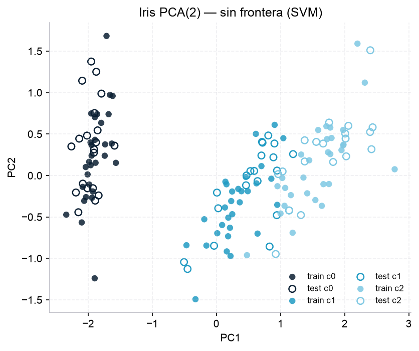<br><sub>Iris</sub></td>
<td align="center">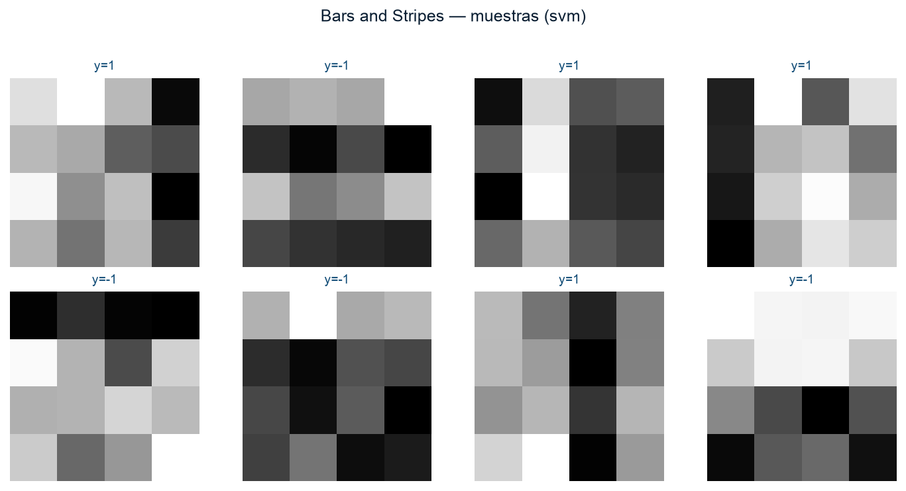<br><sub>Bars and Stripes</sub></td>
<td align="center">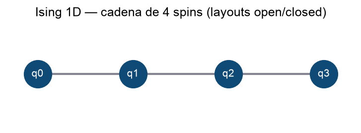<br><sub>4-spin Ising chain</sub></td>
</tr>
<tr>
<td align="center">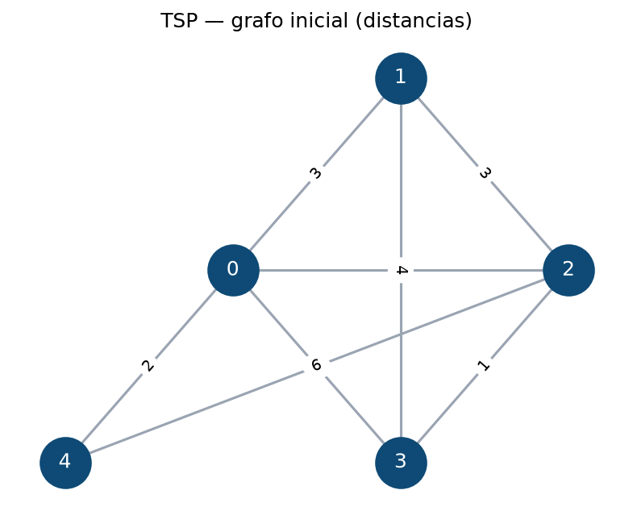<br><sub>TSP</sub></td>
<td align="center">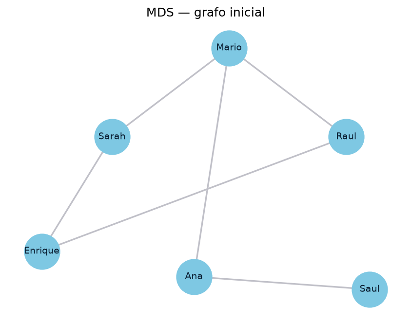<br><sub>MDS</sub></td>
<td align="center">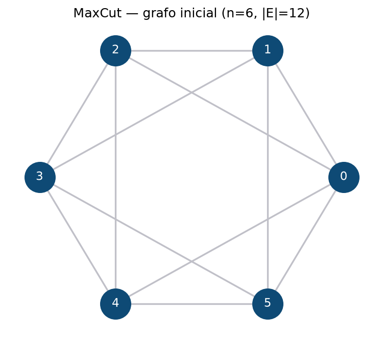<br><sub>MaxCut (HamLib)</sub></td>
</tr>
</table>

The models and solvers compared are:

| Family | Classical | Quantum or quantum-inspired |
|---|---|---|
| Classification | SVM (RBF), Random Forest, XGBoost | QSVM (ZZ map), hybrid QNN, VQC |
| Optimization | brute force, greedy, ILP (PuLP + CBC) | QUBO + Simulated Annealing, QAOA, VQE |

All quantum computation is **statevector simulation on CPU**: 4 qubits in classification and 6 in optimization.

## 3. Representation as the axis

A quantum method does not operate on the data, but on a representation of it. In classification, that representation is the **feature map**; in optimization, the **QUBO/Ising** reformulation. This work treats that transformation as an explicit axis of analysis.

### Classification: from data to Hilbert space

After a stratified split (60/40, seed 123), PCA to 4 components is applied when $d>4$, followed by $\mathrm{MinMax}[0,\pi]$ scaling. The same $\mathbf{x}$ feeds all six models. In the quantum branch, a circuit maps each sample to a 4-qubit state:

```math
\phi:\ \mathbb{R}^4 \longrightarrow \mathcal{H}=\left(\mathbb{C}^2\right)^{\otimes 4}\simeq\mathbb{C}^{16},
\qquad
|\phi(\mathbf{x})\rangle = U_\phi(\mathbf{x})\,|0\rangle^{\otimes 4}.
```

The QSVM uses Qiskit's ZZ feature map (two repetitions, full entanglement), which alternates Hadamard layers with data-dependent phases:

```math
U_\phi(\mathbf{x}) = \Big[\,U_Z(\mathbf{x})\,H^{\otimes 4}\Big]^2,
\qquad
U_Z(\mathbf{x}) = \exp\!\Big(-i\sum_{i} x_i Z_i \;-\; i\sum_{i \lt j}(\pi-x_i)(\pi-x_j)\,Z_iZ_j\Big),
```

and classifies with an SVM on the fidelity kernel:

```math
K(\mathbf{x},\mathbf{x}') = \big|\langle \phi(\mathbf{x}) \,|\, \phi(\mathbf{x}')\rangle\big|^2 .
```

The QNN and the VQC use angle encoding, $U_\phi(\mathbf{x})=\bigotimes_i R_\sigma(x_i)$, followed by a trainable ansatz, and classify from expectation values $\langle Z_i\rangle$.

### Data from a quantum system: Ising

The Ising samples are ground states of the transverse-field model on open and closed 4-spin chains, with $J=-1$ and 100 values of $h\in[0,3]$ per chain:

```math
H(h) = J\sum_{i} Z_i Z_{i+1} \;+\; h\sum_i X_i,
\qquad
y = \mathbf{1}\big[\,h > |J|\,\big].
```

The features are the $2^4$ complex amplitudes of the state (32 real values), reduced by PCA to 4 components that retain 99.9 % of the variance. The field $h$ is not a feature, to avoid label leakage.

### Optimization: from problem to Hamiltonian

All three problems are written as the minimization of a binary quadratic form. With $`x_i\in\{0,1\}`$ and $`z_i = 1-2x_i \in \{\pm1\}`$, each QUBO is equivalent to the energy of a spin Hamiltonian (Lucas, 2014):

```math
\min_{\mathbf{x}\in\{0,1\}^n} \mathbf{x}^\top Q\,\mathbf{x}
\quad\Longleftrightarrow\quad
\min_{\mathbf{z}\in\{\pm1\}^n} H_C(\mathbf{z}) = \sum_{i \lt j} J_{ij}\, z_i z_j + \sum_i h_i\, z_i + \text{const}.
```

| Problem | QUBO / Ising used |
|---|---|
| TSP | $`\displaystyle \sum_{r} c_r\, y_r + P\Big(1-\sum_r y_r\Big)^2`$, one variable per candidate route, $P=100$ |
| MDS | $\displaystyle A\sum_v x_v + B\sum_v\Big(1-\sum_{u\in N[v]}x_u\Big)^2$, with $A=1$, $B=2$ |
| MaxCut | $\displaystyle C(\mathbf{z})=\sum_{(i,j)\in E}\frac{1-z_iz_j}{2}$, no penalties |

QAOA prepares the variational state by alternating the cost Hamiltonian and a mixer $B=\sum_i X_i$, over $p$ layers:

```math
|\boldsymbol\gamma,\boldsymbol\beta\rangle = \prod_{k=1}^{p} e^{-i\beta_k B}\, e^{-i\gamma_k H_C}\; |+\rangle^{\otimes n},
\qquad
(\boldsymbol\gamma^\star,\boldsymbol\beta^\star) = \arg\min_{\boldsymbol\gamma,\boldsymbol\beta}\ \langle \boldsymbol\gamma,\boldsymbol\beta|\,H_C\,|\boldsymbol\gamma,\boldsymbol\beta\rangle .
```

SA, QAOA and VQE share exactly the same energy; they differ in how they search for its minimum.

## 4. Classification: quantum only ties on the easiest case

<p align="center">
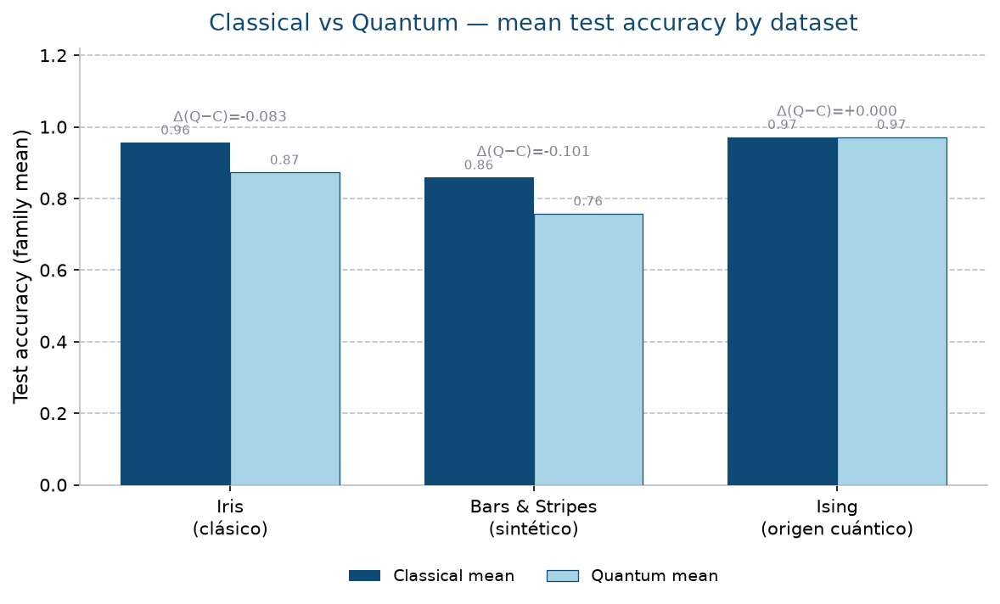
</p>

The mean accuracy of the quantum family is **0.083 below the classical one on Iris and 0.101 below on Bars and Stripes**; on Ising both means are equal (0.971). Ising is also the dataset on which all six models reach at least 0.95 accuracy: parity appears where the problem is already easy for everyone.

| Test F1 | Iris | Bars and Stripes | Ising | Mean | Mean training time |
|---|---:|---:|---:|---:|---:|
| **SVM (RBF)** | **0.967** | **0.870** | **0.985** | **0.940** | **2 ms** |
| Random Forest | 0.950 | 0.854 | 0.969 | 0.925 | 63 ms |
| XGBoost | 0.950 | 0.849 | 0.937 | 0.912 | 94 ms |
| QSVM | 0.730 | 0.758 | **0.985** | 0.825 | 0.53 s |
| QNN | 0.933 | 0.815 | 0.937 | 0.895 | 2.6 s |
| VQC | 0.950 | 0.688 | 0.969 | 0.869 | 24.4 s |

**The ZZ kernel overfits on conventional datasets.** On Iris, the QSVM gets 96.7 % of the training set right and only 73.3 % of the test set: the largest generalization gap in the study (0.233). It makes 16 errors out of 60, including on setosa, the class the other five models classify without error. On the plane of the first two principal components, its boundary breaks into islands where the SVM draws three smooth regions:

<table>
<tr>
<td align="center">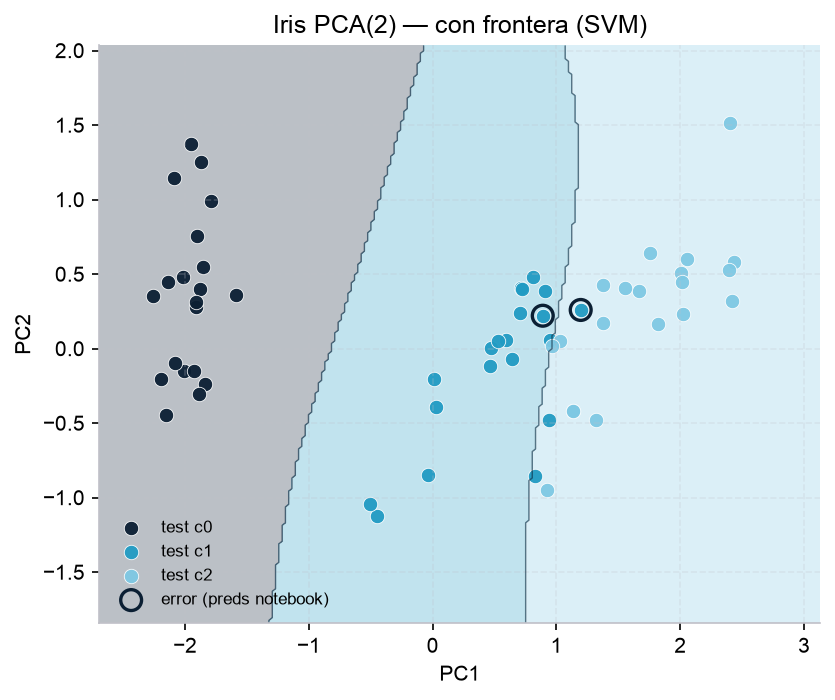<br><sub>SVM-RBF: F1 0.967, 2 errors in the versicolor/virginica overlap</sub></td>
<td align="center">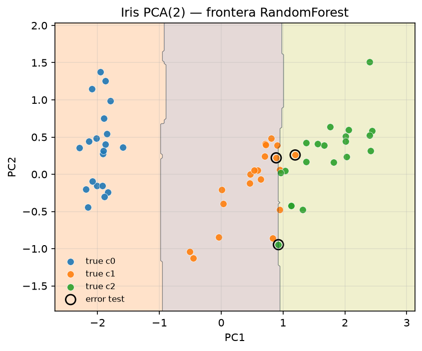<br><sub>Random Forest: F1 0.950</sub></td>
<td align="center">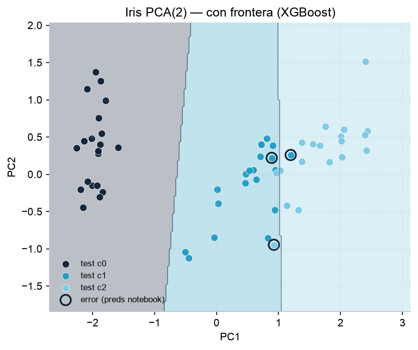<br><sub>XGBoost: F1 0.950</sub></td>
</tr>
<tr>
<td align="center">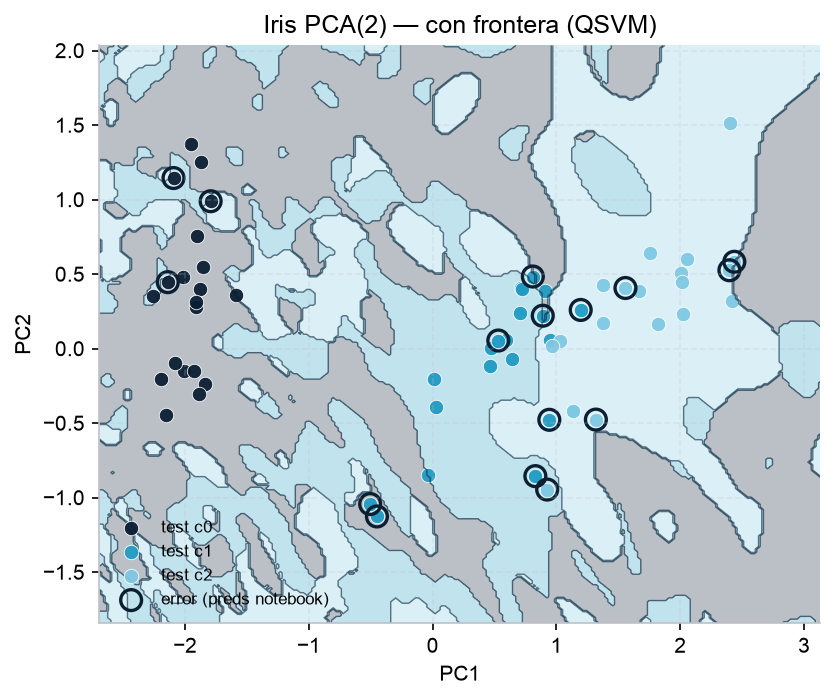<br><sub>QSVM-ZZ: F1 0.730, 16 errors</sub></td>
<td align="center">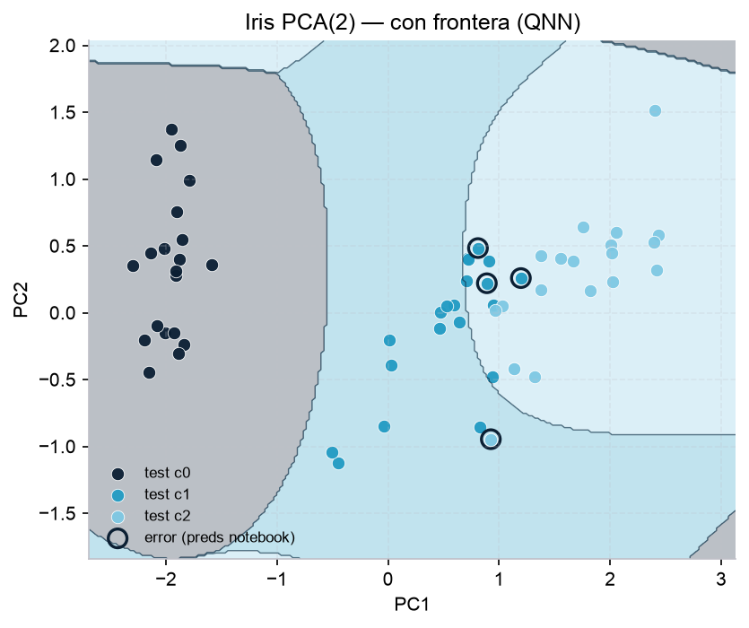<br><sub>QNN: F1 0.933</sub></td>
<td align="center">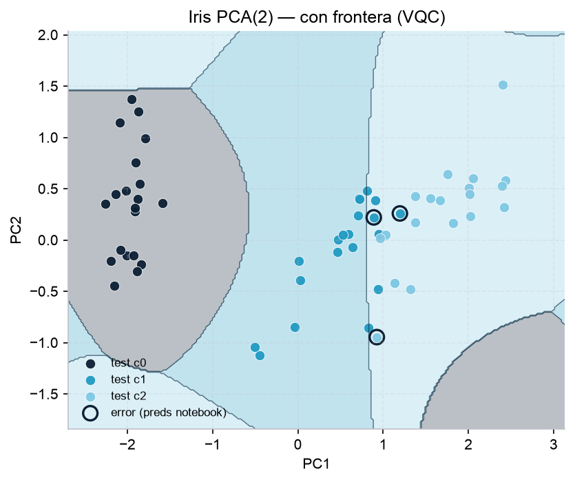<br><sub>VQC: F1 0.950</sub></td>
</tr>
</table>

<sub>Decision boundaries on Iris. Top row: classical models; bottom row: quantum models. Each panel evaluates the trained model on the PC1–PC2 plane, with the other two components fixed at the training mean; circles mark the actual test errors.</sub>

The trees draw almost straight cuts, and the QNN and VQC smooth boundaries; only the QSVM fragments the plane. On Bars and Stripes, the first two components do not separate the classes: the SVM assigns almost the whole plane to a single class and still gets 87 % of the test set right, because its decision depends on the third and fourth components. On that same plane, the QSVM again splits the space into islands:

<table>
<tr>
<td align="center">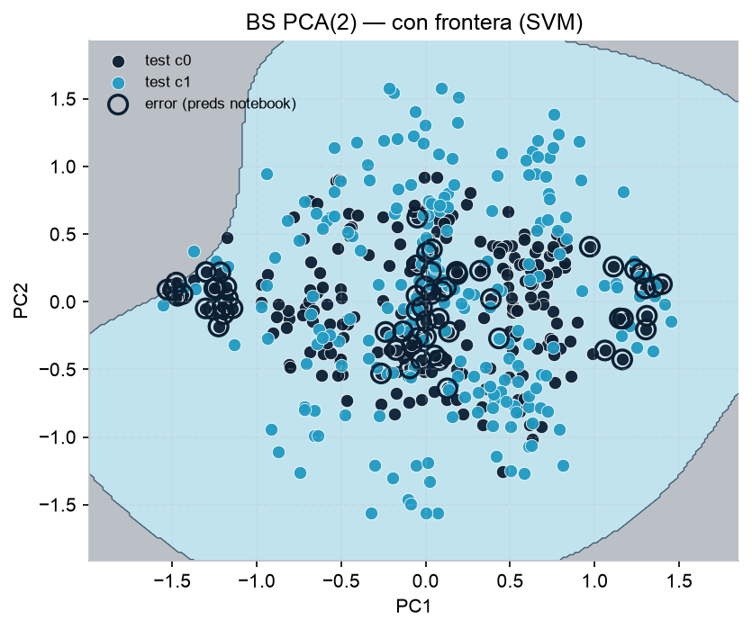<br><sub>SVM-RBF: F1 0.870</sub></td>
<td align="center">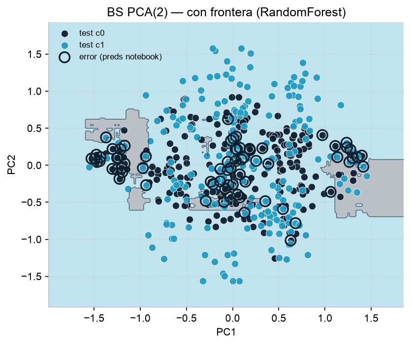<br><sub>Random Forest: F1 0.854</sub></td>
<td align="center">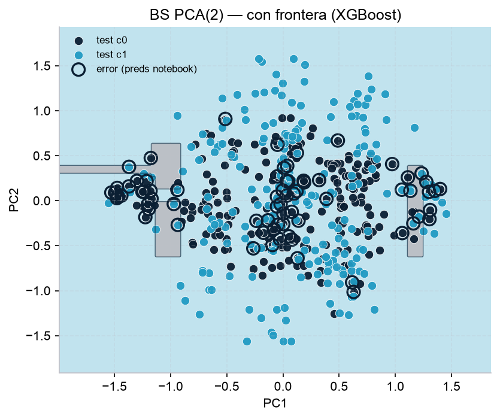<br><sub>XGBoost: F1 0.849</sub></td>
</tr>
<tr>
<td align="center">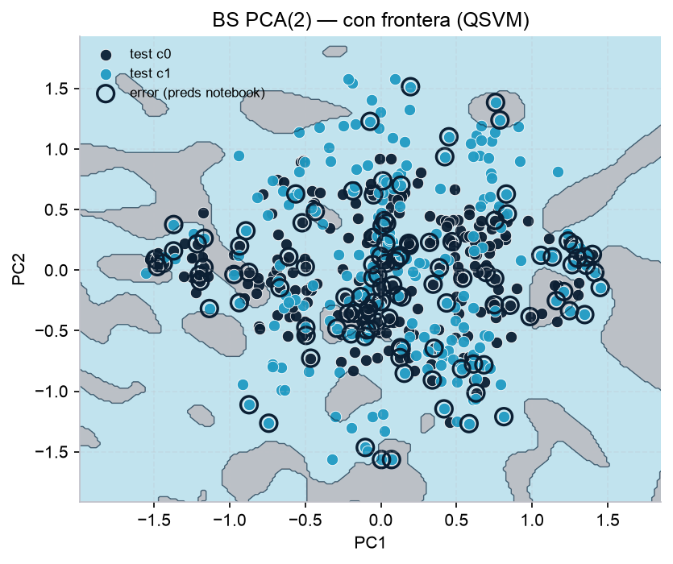<br><sub>QSVM-ZZ: F1 0.758</sub></td>
<td align="center">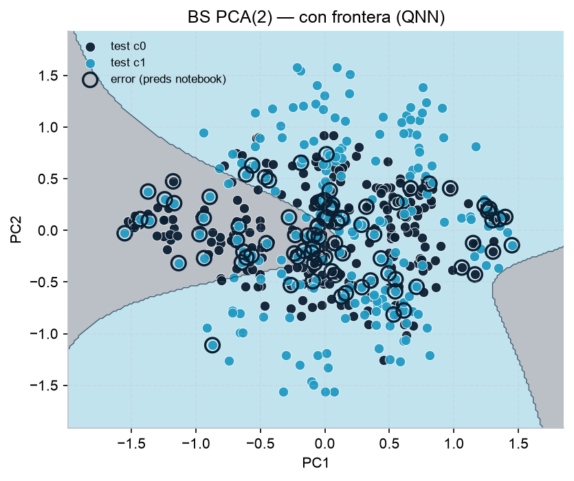<br><sub>QNN: F1 0.815</sub></td>
<td align="center">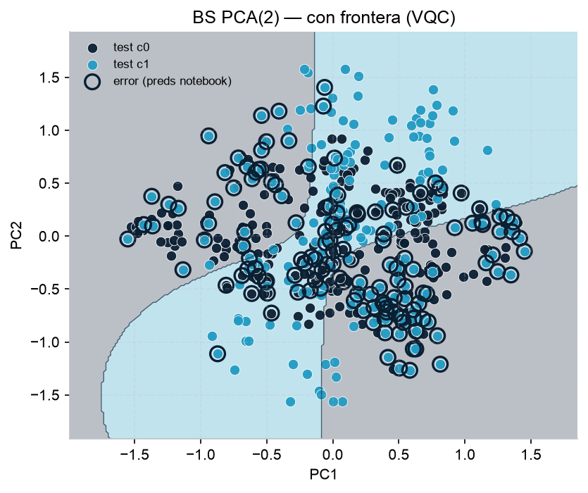<br><sub>VQC: F1 0.688</sub></td>
</tr>
</table>

<sub>Decision boundaries on Bars and Stripes, built the same way. The PC1–PC2 plane only shows a slice of each boundary.</sub>

**The tie on Ising does not show physical affinity.** It would be tempting to read it as the ZZ map capturing the $Z_iZ_{i+1}$ structure of the Hamiltonian. The experiment does not support that: the map acts on four principal components of the amplitudes, not on the spins, and every model solves the dataset.

**Cost changes scale.** No quantum model lies on the quality–cost frontier: the SVM has both the best mean F1 and the lowest training time. The QNN, the best quantum model on average, trains three orders of magnitude slower, and the VQC four. At prediction time, the QSVM and the VQC are two to three orders of magnitude slower than the classical models.

<p align="center">
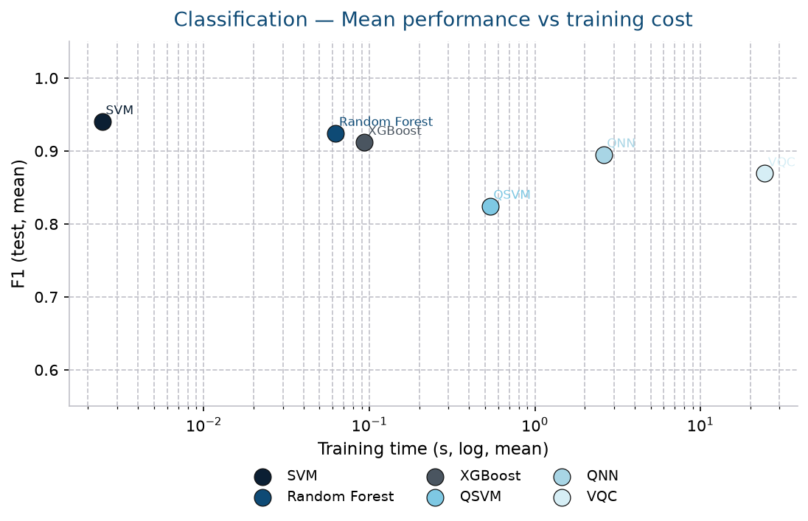
</p>

## 5. Optimization: almost every method reaches the optimum, at different costs

<p align="center">
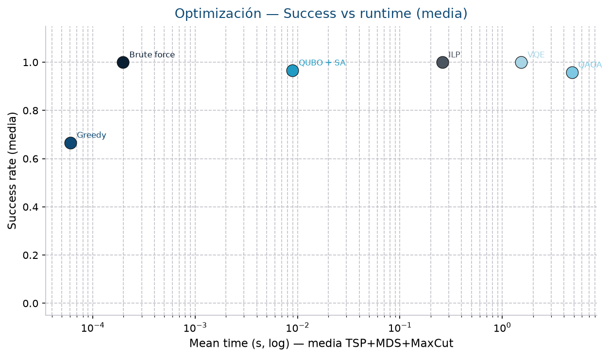
</p>

| Success rate · mean time | TSP ($C^\star=16$) | MDS ($C^\star=2$) | MaxCut ($C^\star=8$) |
|---|---:|---:|---:|
| Brute force | 1.00 · 60 µs | 1.00 · 0.2 ms | 1.00 · 0.3 ms |
| Greedy | 1.00 · 90 µs | **0.00** · 40 µs | 1.00 · 60 µs |
| ILP | 1.00 · 0.07 s | 1.00 · 0.05 s | 1.00 · 0.66 s |
| QUBO + SA | **0.90** · 17 ms | 1.00 · 7 ms | 1.00 · 3 ms |
| QAOA | 1.00 · 1.1 s | **0.875** · 12.6 s | 1.00 · 0.64 s |
| VQE | 1.00 · 2.0 s | 1.00 · 1.6 s | 1.00 · 0.98 s |

With $n\le 6$, enumeration goes through all $2^6=64$ bitstrings in under a millisecond and is the reference, not a weak baseline. Only three cases fail, each for a different reason:

| Failure | What happens |
|---|---|
| Greedy on MDS | It picks the vertex with the largest coverage first and never undoes that choice: size 3 versus the optimum of 2 |
| SA on TSP (2 of 20 seeds) | With one variable per route, every flip from a feasible route adds the penalty of 100: both feasible routes are local minima |
| QAOA on MDS (1 of 8 seeds) | The optimizer ends at higher-energy parameters and returns a set that leaves one vertex undominated |

<table>
<tr>
<td align="center">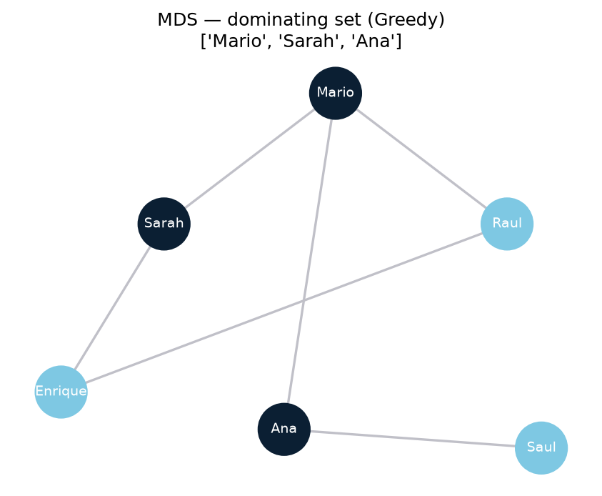<br><sub>Greedy: size 3, not optimal</sub></td>
<td align="center">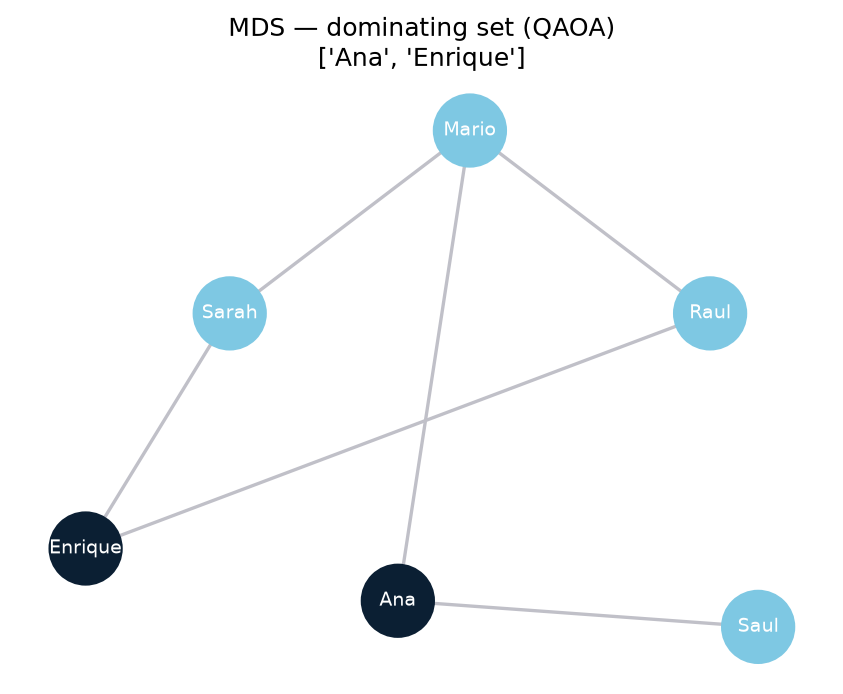<br><sub>QAOA: optimum {Ana, Enrique} in 7 of 8 seeds, 12.6 s per run</sub></td>
</tr>
</table>

The QAOA failure is not caused by the formulation: SA solves **the same QUBO** in all 20 seeds in 7 ms. On MDS, the probability of measuring the optimum follows the energy reached by the optimizer: it is zero for the failed seed and between 0.62 and 0.75 for the six best ones (mean 0.53).

### A success rate of 1 does not always prove the circuit works

On TSP and MDS, QAOA and VQE return the lowest-energy bitstring among thousands of samples. With $N$ uniform samples over 64 bitstrings and a single optimum, the probability of never seeing it is

```math
\Pr[\text{optimum missed}] = \left(1-\tfrac{1}{64}\right)^{N},
\qquad
N=3000 \;\Rightarrow\; \approx e^{-47}\approx 0 .
```

A uniform sampler would also "succeed". That is why the measure that sets a variational solver apart is the probability it concentrates on the optimum, not its success rate. Where it can be measured, there is concentration: on MaxCut, with the saved final parameters, the QAOA state assigns **probability 0.93 to the optimal cuts, versus 0.28 for a uniform sample**.

<p align="center">
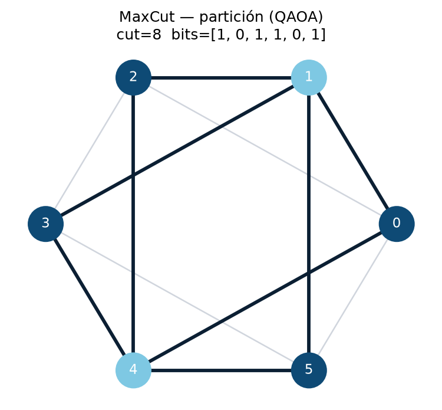
</p>

## 6. What can and cannot be claimed

| Can be claimed | Cannot be claimed |
|---|---|
| With 4–6 simulated qubits, no quantum model or solver beats the best classical one | That there is no quantum advantage at larger scale |
| Quality parity, when it appears, comes with a higher time cost | That the tie on Ising is due to the physics of the chain |
| The ZZ map generalizes worse than an RBF kernel on Iris and Bars and Stripes | How much of the cost is due to simulation and how much to the method |
| QAOA concentrates probability on MaxCut (0.93 versus 0.28) | That QAOA and VQE concentrate probability on TSP and MDS, based on their success rate |

This regime measures **closeness to classical, not asymptotic advantage** (Preskill, 2018; Thanasilp et al., 2024). The cost of simulating a circuit grows as $2^n$, and the questions that remain open require scale: 8- and 16-spin Ising chains encoded directly in qubits, larger QUBO instances with increasing $p$, and execution on real hardware.

## 7. Repository structure

```text
.
├── Notebooks/
│   ├── lib/                      shared utilities (paths and figures)
│   ├── Classification/
│   │   ├── IrisClassification/   one notebook per model + metrics/ + figures/
│   │   ├── BSClassification/
│   │   ├── IsingClassification/
│   │   └── ResultsClassification/   aggregates metrics and builds the comparisons
│   └── Optimization/
│       ├── TSPOptimization/      one notebook per solver + metrics/ + figures/
│       ├── MinimumDominatingSetOptimization/
│       ├── MaxCutOptimization/   includes instance/hamlib_maxcut.json
│       └── ResultsOptimization/
├── Documento/                    thesis in LaTeX (main.tex, Capitulos/, Estilos/, Imagenes/)
├── Defensa/                      defense slides in Beamer
└── requirements.txt              pinned dependencies
```

Each model or solver notebook writes its metrics to JSON. The `Results*` notebooks only read those JSON files and build the comparison tables and figures; every number in the thesis, the slides and this README comes from them.

## 8. Reproduction

```bash
python3.14 -m venv .venv && source .venv/bin/activate
pip install -r requirements.txt
pip install qiskit-machine-learning        # not pinned in requirements.txt
```

1. Run the notebooks in each case folder, in any order. Each one writes its JSON to `metrics/` and its figures to `figures/`.
2. Run the `Results_*.ipynb` notebooks in `ResultsClassification/` and `ResultsOptimization/`.
3. Build the thesis and the slides with two `pdflatex` passes:

```bash
cd Documento && pdflatex main.tex && pdflatex main.tex
cd ../Defensa && pdflatex defensa.tex && pdflatex defensa.tex
```

Seeds are fixed in the splits and in the stochastic solvers. Times are wall-clock on a single machine and are only comparable in order of magnitude.

## Main references

- Bowles, J., Ahmed, S., & Schuld, M. (2024). *Better than classical? The subtle art of benchmarking quantum machine learning models*. [arXiv:2403.07059](https://doi.org/10.48550/arXiv.2403.07059)
- Farhi, E., Goldstone, J., & Gutmann, S. (2014). *A quantum approximate optimization algorithm*. [arXiv:1411.4028](https://doi.org/10.48550/arXiv.1411.4028)
- Havlíček, V., et al. (2019). *Supervised learning with quantum-enhanced feature spaces*. Nature, 567, 209–212. [doi:10.1038/s41586-019-0980-2](https://doi.org/10.1038/s41586-019-0980-2)
- Huang, H.-Y., et al. (2021). *Power of data in quantum machine learning*. Nature Communications, 12, 2631. [doi:10.1038/s41467-021-22539-9](https://doi.org/10.1038/s41467-021-22539-9)
- Lucas, A. (2014). *Ising formulations of many NP problems*. Frontiers in Physics, 2, 5. [doi:10.3389/fphy.2014.00005](https://doi.org/10.3389/fphy.2014.00005)
- Peruzzo, A., et al. (2014). *A variational eigenvalue solver on a photonic quantum processor*. Nature Communications, 5, 4213. [doi:10.1038/ncomms5213](https://doi.org/10.1038/ncomms5213)
- Preskill, J. (2018). *Quantum computing in the NISQ era and beyond*. Quantum, 2, 79. [doi:10.22331/q-2018-08-06-79](https://doi.org/10.22331/q-2018-08-06-79)
- Sawaya, N. P. D., et al. (2024). *HamLib: A library of Hamiltonians for benchmarking quantum algorithms and hardware*. Quantum, 8, 1559. [doi:10.22331/q-2024-12-11-1559](https://doi.org/10.22331/q-2024-12-11-1559)
- Thanasilp, S., Wang, S., Cerezo, M., & Holmes, Z. (2024). *Exponential concentration in quantum kernel methods*. Nature Communications, 15, 5200. [doi:10.1038/s41467-024-49287-w](https://doi.org/10.1038/s41467-024-49287-w)

The full bibliography is in the thesis.
